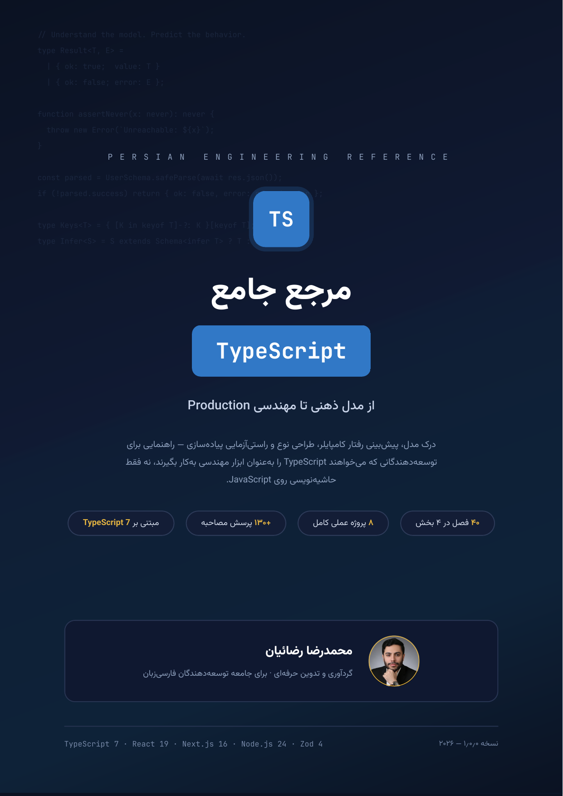
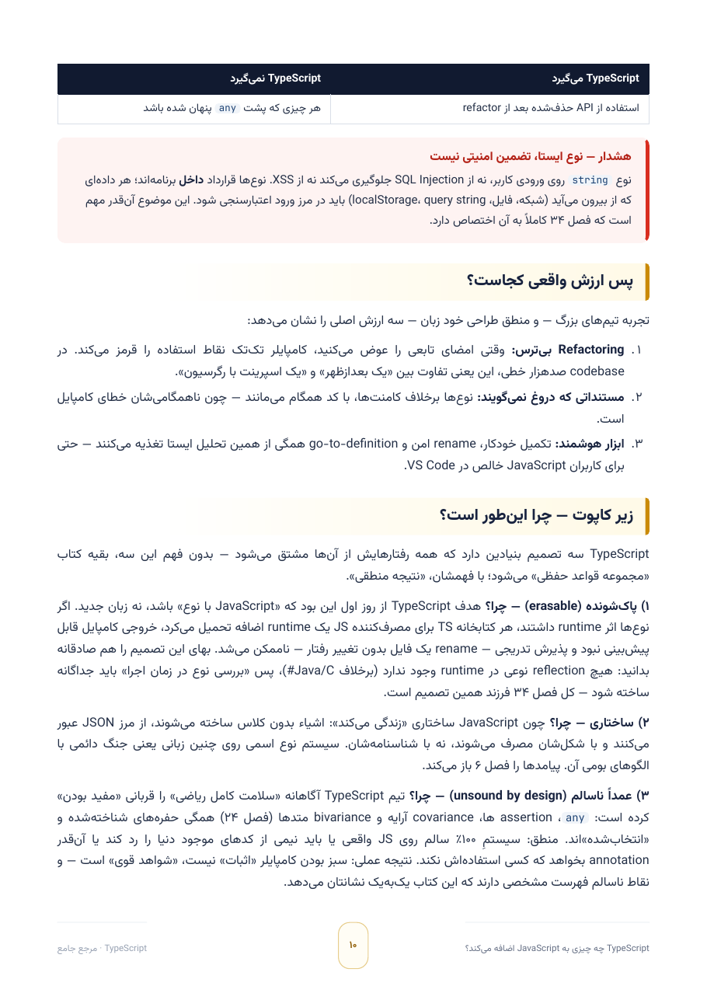

<div align="center">



# مرجع جامع TypeScript
### از مدل ذهنی تا مهندسی Production

**کتاب مرجع فارسی TypeScript — نویسنده: محمدرضا رضائیان**


### [🌐 نسخه آنلاین و دانلود](https://rezaian-dev.github.io/typescript-persian-guide/) · [⬇️ دانلود مستقیم PDF](TypeScript-Persian-Guide.pdf)

</div>

---

<div dir="rtl">

## 📖 درباره کتاب

این کتاب یک مرجع کامل و حرفه‌ای برای TypeScript به زبان فارسی است — نه یک «آموزش syntax»، بلکه تلاشی برای ساختن **مدل ذهنی درست**: این‌که کامپایلر واقعاً چه می‌کند، چرا زبان این‌طور طراحی شده، و چطور از سیستم نوع به‌عنوان ابزار مهندسی استفاده کنیم.

- **۲۲۰ صفحه A4** با صفحه‌آرایی حرفه‌ای — متن کاملاً قابل جست‌وجو و انتخاب، بوکمارک سه‌سطحی، فهرست با شماره صفحه دقیق
- هر فصل یک بخش **«زیر کاپوت — چرا این‌طور است؟»** دارد که سازوکار درونی کامپایلر و چراییِ تصمیم‌های طراحی زبان را عمیق باز می‌کند
- هر فصل با **دو پرسش مصاحبه با پاسخ تشریحی** بسته می‌شود؛ پیوست A نیز ۵۰ پرسش سطح‌بندی‌شده دارد — مجموعاً **+۱۳۰ پرسش مصاحبه**
- **هر ۱۸۶ قطعه‌کد کتاب با کامپایلر رسمی راستی‌آزمایی شده است** — روی TypeScript 7.0.2 (کامپایلر native) و 6.0.3، با صفر خطا؛ قطعه‌های «خطای عمدی» نیز بررسی شده‌اند که دقیقاً همان خطای ادعاشده را تولید کنند
- پوشش کامل **گذار TypeScript 6 → 7** و کامپایلر native جدید

<details>
<summary>📄 <b>نمونه صفحه از کتاب</b> (کلیک کنید)</summary>
<br/>
<div align="center"></div>
</details>

## 🗂 ساختار کتاب

| بخش | فصل‌ها | موضوع |
|---|---|---|
| **۱ — بنیادها و مدل ذهنی سیستم نوع** | ۱ تا ۱۲ | ارزش واقعی TypeScript، زنجیره ابزار، tsconfig، استنتاج، widening، structural typing، narrowing، union/intersection، توابع و آرایه‌ها |
| **۲ — طراحی نوع پیشرفته** | ۱۳ تا ۲۶ | interface و type، جنریک‌ها، keyof/typeof، conditional و mapped types، template literals، utility types، discriminated unions، type guards، variance، type-level programming |
| **۳ — کامپایلر، ابزار و معماری** | ۲۷ تا ۳۳ | پرچم‌های strict، ماژول‌ها و resolution، اکوسیستم d.ts، مهاجرت JS→TS، project references، تست نوع، **گذار TypeScript 6→7** |
| **۴ — TypeScript در سیستم‌های Production** | ۳۴ تا ۴۰ | اعتبارسنجی مرزی با Zod، مدیریت خطا با Result، state machine تایپ‌شده، React، fullstack type safety، طراحی API client، انتشار پکیج تایپ‌شده |
| **پیوست‌های A تا H** | — | ۵۰ پرسش مصاحبه، واژه‌نامه فارسی-انگلیسی، مرجع گزینه‌های کامپایلر، عیب‌یابی، چک‌لیست مهاجرت، الگوهای طراحی نوع، نقشه راه JS→TS، منابع |

## 🧪 پروژه‌های عملی ([`examples/`](examples/))

هشت پروژه کامل که الگوهای کتاب را در کد واقعی نشان می‌دهند — همه با TypeScript 7.0.2 و 6.0.3 راستی‌آزمایی شده‌اند:

| پروژه | موضوع | فصل مرتبط |
|---|---|---|
| [`api-client`](examples/api-client/) | کلاینت API جنریک با استنتاج نوع پاسخ از نقشه endpoint ها | ۳۹ |
| [`boundary`](examples/boundary/) | اعتبارسنجی runtime در مرز با Zod — الگوی parse, don't validate | ۳۴ |
| [`repository`](examples/repository/) | الگوی repository جنریک | ۱۴ |
| [`state-machine`](examples/state-machine/) | ماشین حالت با discriminated union و گذارهای type-safe | ۳۶ |
| [`typed-emitter`](examples/typed-emitter/) | event emitter تایپ‌شده با تست‌های type-level | ۲۶ |
| [`form-flow`](examples/form-flow/) | گردش‌کار فرم چندمرحله‌ای | ۳۵ |
| [`react-feature`](examples/react-feature/) | فیچر React با props تایپ‌شده | ۳۷ |
| [`next-boundary`](examples/next-boundary/) | مرز داده در Next.js | ۳۸ |

اجرای پروژه‌ها:

```bash
cd examples
npm install
npx tsc -p state-machine --noEmit   # بررسی نوع
```

## ✅ کیفیت و اعتبارسنجی

این کتاب از پنج دروازه کیفیت عبور کرده است:

- **طراحی و رندر** — بازبینی تصویری صفحه‌به‌صفحه: بدون سرریز متن، بدون بریدگی، بدون glyph مفقود
- **RTL/bidi** — متن فارسی راست‌به‌چپ با کد انگلیسی چپ‌به‌راست به‌درستی در کنار هم؛ خروجی PDF از این نظر ممیزی شده است
- **راستی‌آزمایی کد** — کامپایل همه ۱۸۶ قطعه‌کد با دو نسخه کامپایلر رسمی: صفر خطا
- **ناوبری** — فهرست با شماره‌های دقیق، بوکمارک کامل، metadata استاندارد
- **مبنای فنی به‌روز** — نسخه‌ها از منابع رسمی راستی‌آزمایی شده‌اند: TypeScript 7.0.2 / 6.0.3، React 19، Next.js 16، Zod 4، Node.js 24

## 🎯 این کتاب برای چه کسی است؟

- توسعه‌دهنده JavaScript که می‌خواهد TypeScript را **اصولی و عمیق** یاد بگیرد، نه سرسری
- توسعه‌دهنده TypeScript که می‌خواهد «چرا»های پشت رفتار کامپایلر را بفهمد
- کسی که برای **مصاحبه فنی** آماده می‌شود (+۱۳۰ پرسش با پاسخ تشریحی)
- تیمی که مهاجرت JS→TS یا ارتقا به TypeScript 7 را پیش رو دارد

## 📜 حقوق

متن و محتوای کتاب © محمدرضا رضائیان — همه حقوق محفوظ است.
تایپوگرافی کتاب با فونت‌های آزاد **Vazirmatn** و **JetBrains Mono** (هر دو تحت پروانه SIL OFL).

</div>

<div align="center">

**اگر این کتاب برایتان مفید بود، با ⭐ از آن حمایت کنید.**

</div>
